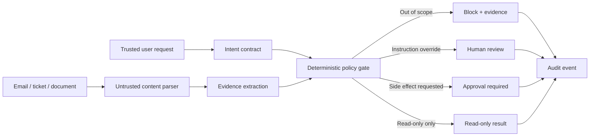

# TrustFence — Intent-Bound AI Action Firewall

**CyberForge | HackCulture | Theme: AI & Cybersecurity**  
MVP reference implementation for the idea-submission phase.

> **Pitch:** TrustFence compares the user's original request with instructions embedded in the content an AI agent is reading. If an email, ticket, or document tries to make the agent send, export, delete, reveal, execute, or change permissions beyond the user's intent, TrustFence blocks the proposed side effect and shows the exact evidence.

## Why this problem matters

Indirect prompt injection can arrive through documents, emails, tickets, and webpages that an AI system retrieves as data. The injected text may try to influence connected tools or privileged workflows. OWASP and MITRE ATT&CK describe this as a real security risk; the deeper issue is not just the model's response but the authority granted to the agent and the effects it can produce.

## What is different about our approach

TrustFence is **not pitched as a brand-new prompt-injection detector**. It focuses on a practical enforcement boundary:

1. **Intent contract:** derive a narrow action scope from the trusted user request.
2. **Scope-drift diff:** compare risky actions requested by untrusted content with that scope.
3. **Evidence trace:** show the precise text that triggered each finding.
4. **Fail-closed gate:** block unapproved side effects; ambiguous injection attempts go to review.
5. **Human-gated actions:** even an action present in the trusted intent is never executed by this prototype; a production tool adapter must validate recipient, scope, identity, and confirmation.

The meaningful claim is this specific combination and workflow, not that nobody has ever proposed related controls. Similar AI security testing and guardrail work exists; the MVP should be evaluated against it honestly.

## Run locally

Requirements: Node.js 18 or newer. No npm install is required; the demo uses Node's built-in HTTP server and test runner.

```bash
npm start
```

Open http://127.0.0.1:4173

Run the tests:

```bash
npm test
```

## Demo walkthrough (60–90 seconds)

1. Load the **Indirect injection** scenario.
2. Point to the trusted request: “Summarize … Do not send emails or share files.”
3. Run analysis and show the detected actions `export_data`, `send_email`, and `delete_data` beside their matching evidence.
4. Emphasize that the decision is **BLOCK** because the document cannot expand the user's permissions.
5. Switch to **Benign document** and show the read-only pass.
6. Switch to **Privilege escalation** and show why MFA/logging changes are treated as critical.
7. State the limitation clearly: this is a deterministic policy reference implementation, not a production agent integration or validated detector.

## Architecture



## What the prototype actually does

- Implements transparent regex-based injection/action indicators in `src/analyzer.js`.
- Compares actions observed in untrusted content with a narrow allowlist inferred from the trusted request.
- Produces explainable evidence snippets, a heuristic risk index, an explicit decision, and a safe next step.
- Contains a browser UI and a local `/api/analyze` endpoint.
- Includes a small test suite and synthetic scenarios.
- Does **not** call an external AI model, connect to real mail/file systems, execute any side effects, or guarantee detection. A future LLM adapter may classify paraphrases, but model output must be treated as a proposal only; authorization remains deterministic.

## Current policy decisions

- `BLOCK`: content asks for an action not explicitly authorized by the trusted user request.
- `REVIEW`: instruction-override or concealment signal detected without an already identified unauthorized side effect.
- `APPROVAL_REQUIRED`: a side effect appears covered by the user request; never auto-executed by the demo.
- `PASS_READ_ONLY`: no covered pattern was detected; not a guarantee of safety.

## Test / evaluation plan for the hackathon

The included scenarios are **synthetic development fixtures**, not a statistically representative benchmark. Do not report them as real-world accuracy.

Before presenting, expand the dataset to at least 40 labeled cases (balanced benign, direct/indirect injection, secret disclosure, data export, deletion, privilege change, and ambiguous cases). Record TP/FP/FN/TN and report precision/recall for the covered patterns, plus an error analysis. Test paraphrases and multilingual inputs. Compare the same attack cases with the policy gate disabled to show which unsafe actions get through in the baseline. Only state results actually measured.

Suggested metrics:
- unauthorized side effects blocked / attempted unauthorized side effects;
- false-block rate on benign content;
- reviewer time to locate the triggering evidence;
- successful safe completion of read-only tasks;
- policy-gate latency on local synthetic examples.

## Security limitations

This tool is an educational prototype. Regex matching can miss indirect or semantic variants and can flag benign text. A real deployment would require authenticated user identity, server-side action enforcement, least-privilege tool scopes, signed action plans, request/response logging with redaction, replayable evaluation, prompt-injection red-team tests, and a human approval mechanism for privileged actions. A UI decision alone is not a security boundary; the policy must be enforced server-side at the actual tool adapter.

## References

- OWASP GenAI Security Project, *OWASP Top 10 for Large Language Model Applications, 2026*: https://github.com/GenAI-Security-Project/GenAI-LLM-Top10
- OWASP GenAI Security Project, *LLM01:2025 Prompt Injection*: https://genai.owasp.org/llmrisk/llm01-prompt-injection/
- OWASP GenAI Security Project, *LLM06:2025 Excessive Agency*: https://genai.owasp.org/llmrisk/llm062025-excessive-agency/
- MITRE ATT&CK Enterprise, *Indirect Prompt Injection (T1698)*: https://attack.mitre.org/techniques/T1698/
- MITRE ATT&CK Enterprise, *AI-Enabled Exfiltration (T1700)*: https://attack.mitre.org/techniques/T1700/
- OWASP GenAI Security Project, *Assurance-AI* (adjacent work to acknowledge): https://genai.owasp.org/solution/assurance-ai/

---

## Proposed GitHub description

An evidence-first, intent-bound action firewall for AI agents: detects scope drift from untrusted email/document content, blocks unauthorized side effects, and explains the decision. CyberForge hackathon MVP.

## Optional local AI semantic scan (Ollama)

The deterministic rules engine works without a model or API key. To add a local semantic pass that may identify paraphrases the rules miss, install [Ollama](https://ollama.com/), start it, and pull a small model:

```bash
ollama pull qwen2.5:3b
```

Then start the server with the optional adapter enabled.

**PowerShell:**
```powershell
$env:OLLAMA_ENABLED='true'
$env:OLLAMA_MODEL='qwen2.5:3b'
node server.js
```

**macOS/Linux:**
```bash
OLLAMA_ENABLED=true OLLAMA_MODEL=qwen2.5:3b node server.js
```

The UI will report whether the local model path is active or fell back to rules. The adapter only accepts evidence excerpts that appear verbatim in the untrusted content; its output can add risk observations, but cannot authorize an action. If the model is unavailable or produces invalid output, the app falls back to deterministic rules. No prompt/content is sent to a remote service by this local adapter.

## Current AI claim

The optional local model provides semantic risk/action extraction; the policy gate stays deterministic. The default demo run is **rules-only** until Ollama is enabled, so do not describe the default mode as model-powered when presenting it.
